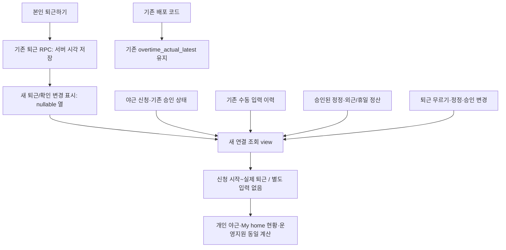

# 야근 신청과 실제 퇴근 연결

2026-11-05, 공유 브랜치 `261104-end`. 사용자 승인 후 공유 DB에 원격 `20261105031646_overtime_checkout_link`를 적용했다. test/main 사이트 배포는 하지 않았다.

## 기준

- 일반 야근은 신청 시작 시각부터 본인의 실제 퇴근 시각까지 계산한다. 신청 종료 시각은 예정값이다. 더 일하거나 일찍 퇴근한 경우도 허용하며, 시작 전 퇴근은 0분이다. 별도 실제 시간·휴게시간 입력 UI는 제거한다.
- 기존 승인 기준은 유지한다. 승인 대기 중 퇴근해도 출퇴근 원본은 저장하며 나중에 승인되면 그 기록이 반영된다. 반려·취소는 누적하지 않는다. 야근 신청 없는 늦은 퇴근만으로 야근을 생성하지 않는다.
- 퇴근 무르기 후에는 자동 야근이 사라지고, 다시 퇴근하면 새 실제 시각으로 계산한다. 승인된 출퇴근 정정은 기존 유효 출퇴근 조회와 같은 우선순위로 반영한다. 퇴근 미기록의 나중 확인 입력도 연결한다.
- 기존 수동 입력 행과 과거 휴게 차감값은 변경하지 않는다. 새 실제 퇴근이나 수동 입력 이후 승인된 유효 정정이 없으면 기존 수동 내역을 계속 사용한다. 수동 내역이 없는 기존 실제 퇴근은 데이터를 다시 쓰지 않고 연결 조회한다. 새 자동 연결은 차감 0분이다.
- 하루 여러 승인 야근이 있으면 다음 신청 시작에서 앞 구간을 나누어 중복 합산하지 않는다. 같은 시작 시각의 중복 신청도 한 번만 반영한다. 실제 퇴근 원본은 분할값과 별도로 유지한다.
- 외근 정산과 겹치는 구간은 기존 중복 방지 기준을 유지한다. 주말·공휴일은 별도 근무 확인·정산을 유지하며 평일 야근이 휴일로 이어지면 경계에서 나눈다. 예약 종료로 만든 외근/야근 자동 퇴근이나 근무 확인 무응답의 자동 종료를 실제 야근으로 사용하지 않는다.
- 자정을 넘겼을 때는 전날의 대기·승인 야근이 있고 오늘의 설정된 출근 기준 이전이면 전날 근무로 퇴근·무르기를 할 수 있다. 개인/부서 출근 기준은 기존 `attendance_start_for_date`를 사용한다. 오늘 출근 기록이 있으면 오늘 기록이 우선한다. 기준이 없거나 새 근무 시작 이후라면 기존 다음날 출근·직전 퇴근 확인 흐름을 따른다.

## 구조

별도 자동 보고 행을 반복 삽입하지 않는다. 이미 영속 저장된 출퇴근과 신청을 연결하여 재조회·동시 접속 때 중복이 생기지 않는다. 새 실제 퇴근 여부 표시는 과거 수동 이력 보존과 무르기 시 복귀 방지에 사용한다.

## 준비한 DB 변경

`20261105024604_overtime_checkout_link.sql`:

1. `attendance_clock_ins.overtime_linked_at` nullable 열 1개와 변경 표시 트리거/함수 1개. 기존 행은 일괄 수정하지 않는다.
2. 신청 조회 권한을 그대로 검사하는 내부 연결 조회 함수 1개와 새 `overtime_actual_with_checkout` view. 원본 `overtime_actual_latest`와 정책은 유지하여 아직 배포하지 않은 운영 코드와 호환한다.
3. 기존 실제 야근 입력 보호 함수의 예정 시간 상한·하한만 제거한다. 본인·같은 회사·활성 직원·승인·분 단위·미래 시간 차단·동시 수정 버전·append-only 이력 제약은 유지한다. 이전 저장 API와 과거 차감 필드는 호환용으로 보존한다.
4. 기존 퇴근 함수와 내부 퇴근 무르기 함수의 전날 야근 연결만 보완한다. 외근 복귀 분기와 본인 확인·잠금 순서·서버 시간 사용은 유지한다.

DB 적용 전 기존 출퇴근·무르기·실제 입력 함수의 정의 또는 `leave_read` 정책의 표현식·대상 역할·개수·종류가 검증한 상태와 다르면 중단한다. 내부 조회 함수는 활성 직원·회사와 기존 신청 조회 범위를 확인한다. 일반 직원에게 다른 직원의 원본 출퇴근 조회·수정 권한을 추가하지 않는다.

신규 view 미적용 환경에서는 저장 모듈이 기존 view로 돌아가 과거 내역을 표시하고 UI에 자동 연결 적용 대기를 안내한다. 권한 오류/일반 서버 장애를 성공이나 0시간으로 취급하지 않는다. 새 API가 없는 환경에서 실제 자동 연결이 완료됐다고 보고하지 않는다.

## 화면 갱신·진단

- 본인의 퇴근/무르기/이전 퇴근 확인 뒤 출퇴근·실제 야근·관련 근태·알림 캐시를 무효화한다. 신청 승인/취소/정정 갱신에도 실제 야근을 포함한다. 계정별 쿼리 키와 기존 30초 조회를 유지한다.
- 퇴근 RPC는 `leave.checkout_overtime` 문맥으로 DB 저장과 화면 갱신을 구분한다. 공통 전송 감시와 원래 오류 코드는 유지하며 날짜·직원 UUID·신청 내용은 새 진단에 넣지 않는다.
- 이번 기능은 새 알림을 만들거나 읽음/처리 상태를 바꾸지 않는다. 기존 야근 승인·퇴근 확인 알림의 원본 및 처리 기준을 따른다.

## 검증

- `node scripts/verify-overtime-checkout-db.mjs`: 실제 SQL/PGlite에서 과거 수동 이력·기존 view·요청·RLS 보존, 늦은/이른/시작 전 퇴근, 중복·무르기·재퇴근, 늦은 승인, 승인 정정, 복수 신청, 휴일 경계·외근 중복·가상 종료, 실제 서버 시각의 퇴근/전날 퇴근, 직원/관리자/지정 승인자/동료/타사/익명을 검증한다.
- `node scripts/verify-overtime-checkout-api.mjs`: 실제 조회 모듈의 자동 연결 메타데이터, 과거 API fallback/페이지 재시작·과거 차감 보존, 권한 오류·시간 초과의 실패 유지를 검증한다.
- `node --experimental-strip-types src/features/home/overtime-clock.verify.ts`: 개인 출근 기준 경계, 대기/승인·취소/반려, 전날·오래된 누락, 자동 종료, 새벽 퇴근 완료 뒤 출근 재요구 방지를 검증한다.
- 기존 야근 집계·My home 근태 요약과 실제 개인/관리/외근 컴포넌트의 모의 브라우저 검증을 수행한다. 외부 DB 쓰기는 차단한다.
- 기존 출근 진입 브라우저 회귀, Node 22 빌드, `verify:diagnostics`, `verify:workflow-diagnostics`, 구조도 갱신 및 분석기 9개 검증을 통과했다. 브라우저 검증은 localhost 접근 제한이 없는 실행에서 확인했다. 실제 직원의 출퇴근·야근 저장은 실행하지 않았다.
- 공유 DB 적용 트랜잭션과 적용 후 재조회에서 기존 8개 업무 표의 원본·모든 정책·관련 기존 실행/표 권한·기존 view 정의가 동일함을 확인했다. 출퇴근 108건·야근 수동 보고 1건·신청 47건·프로필 39건·명부 25건·승인자 지정 22건·권한 지정 30건·외근 정산 1건을 보존했다. 과거 행의 새 표시는 모두 NULL이다.
- 실제 `authenticated` 역할의 활성 직원 37계정으로 새/기존 view·내부 조회 범위를 확인했다. 비공개 신청 직접 조회와 익명을 포함한 차단 33건을 통과했다. 조회만 실행하고 트랜잭션을 롤백했으며 로그인·근태를 대신 기록하지 않았다.

## 적용·복구 경계

공유 DB는 사용자 승인 범위만 적용했다. 적용 전 함수 정의·업무 원본 체크섬과 트랜잭션 보존 검사 SQL·검증 결과는 개발 전용 `docs/backups/overtime-checkout-*-20261105.*`에 보관하고 커밋하지 않는다. 기존 데이터 대량 보정·삭제·사용자 승인 상태 변경은 포함하지 않는다. 복구 시 기존 함수 정의로 되돌리고 신규 view 미배포 fallback을 사용하되, 이후 생성된 연결 표시/실제 퇴근 원본은 삭제하지 않는다. test/main 사이트 배포는 이번 범위에 포함하지 않는다.
