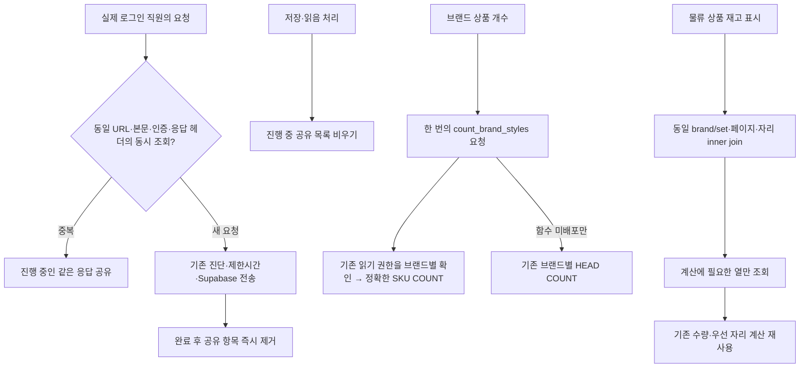

# 상품 개수·창고 재고·공통 알림 조회 최적화

2026-11-04, `261104-1`. 로컬 구현·검증 기록이다. 공유 DB의 새 집계 API는 **적용 승인 대기**, test/main 배포는 하지 않는다.

## 로컬 코드

- `coalesced-read-fetch.ts`: 상품 개수 HEAD/새 집계 RPC, 창고 재고 GET, 공통 업무 알림 RPC의 **동시에 겹치는 동일 조회만** 공유한다. 완료 결과를 캐시하지 않는다. 인증 토큰·모든 응답 관련 헤더·본문이 다르면 공유하지 않는다. 요청 키는 메모리에만 있으며 기록하지 않는다. 관찰용 `x-client-info` 진단 trace ID만 비교 키에서 정규화하고 실제 전송 헤더는 보존한다.
- 쓰기 요청은 진행 중 공유 목록을 지운다. 명시적 AbortSignal/Request 객체는 공유하지 않는다. 파일·다른 RPC·업무 저장 동작은 기존 경로로 보낸다. 전송·본문 실패도 항목을 정리하고 다음 요청은 새로 조회한다. 읽음·처리 완료의 서버 의미는 변경하지 않는다.
- `getWarehouseStockSummary`: 상품 화면의 재고 표시 전용 projection이다. 기존 brand/set 조건·1,000행 페이지·정렬·자리 inner join을 유지한다. 상품명·메모·등록 시각 등 계산에 쓰이지 않는 열을 제외한다. 기존 전체 재고 API와 창고 편집·출고 경로는 유지한다. 요약 캐시 키는 기존 `warehouse-stock-positions` prefix 아래 `product-summary`로 분리하여 기존 저장 뒤 무효화는 유지하고 원본 배열 캐시와 혼합하지 않는다.
- 상품 개수는 같은 브랜드 중복 입력을 제거하고 배포 후 한 RPC로 요청한다. 함수 미존재 `PGRST202`/`42883`만 기존 정확한 HEAD 방식으로 돌아간다. 해당 브라우저 실행 중에는 미존재 RPC를 반복 호출하지 않는다. 권한 오류·서버 장애는 실패로 전달하며 0개로 위장하지 않는다. DB 적용 후 페이지를 새로고침한다.

## 승인 대기 DB 변경

`20261104074533_grouped_brand_style_counts.sql`의 **새 조회 함수 1개** `public.count_brand_styles(uuid[])`와 그 함수의 실행 권한만 추가한다. 직원·상품·기존 함수·정책·트리거·데이터를 수정하지 않는다.

이 함수는 기존 `styles` 읽기 정책 `app.can_read_brand(brand_id)`와 같은 함수를 요청 브랜드마다 한 번 확인한 뒤 정확히 센다. SECURITY DEFINER의 RLS 우회가 새 권한이 되지 않도록 배포 직전 기존 SELECT/ALL 정책이 검증한 하나인지 확인하고 달라지면 적용을 중단한다. 현재 명부 조회·승인 기준도 같은 권한 함수가 결정한다. 로그인 UUID가 없는 요청은 거부하고, authenticated만 실행할 수 있으며 최대 200개 브랜드로 제한한다. 0개 브랜드와 존재하지 않는 브랜드도 안전하게 처리한다. 새로운 RLS 정책을 추가할 때에는 이 전용 집계의 권한 동등성도 다시 검토해야 한다.

적용 전에 원본 정책·함수·실행 권한을 다시 보관하고, 적용 후 일반 직원·관리자·미승인·익명의 결과와 원본 데이터/정책 불변을 검증한다. 복구 시 새 함수를 제거하면 기존 화면은 미배포 fallback으로 돌아간다. 제거 전에는 새 API 사용자를 확인한다. 자동 복구/DB 적용은 실행하지 않는다.

## 검증

- `node scripts/verify-product-read-load.mjs`: 실제 저장 모듈을 묶은 로컬 fixture와 PGlite SQL 검증. 2,101행/3페이지의 전체 재고 결과와 좁은 projection의 수량·미확인·우선순위·자리·브랜드 범위 결과가 일치한다. 상품 개수 중복 브랜드·빈 요청·미배포 fallback·권한 오류 전파를 확인한다.
- 실제 전송 공유 모듈에서 일반 직원 동시 조회 12개(각기 다른 진단 trace 포함)가 1회 요청이 된다. 다른 계정 분리, 저장 이후 새 조회, 취소 신호 분리, 실패 정리와 재조회도 통과했다. 네트워크 전체 호출이 항상 1회가 된다는 뜻은 아니다.
- 로컬 DB에서 일반 활성 직원·미승인 직원의 기존 RLS COUNT와 새 집계가 같고 익명 실행은 거부된다. 정책과 상품 원본은 함수 추가로 바뀌지 않는다. 2,002 SKU/2브랜드 fixture의 권한 함수 실행은 2,002→2회이며 정확한 개수는 같다. 실제 응답시간 개선율이 아니다.
- 공유 DB에서는 기존 일반 직원 UUID의 실제 authenticated 역할로 기존 COUNT 2,445개를 확인하고, 같은 직원의 기존 권한 함수를 먼저 평가하는 제안 SELECT도 2,445개임을 읽기 전용·ROLLBACK으로 비교했다. 새 함수를 배포하거나 실제 직원의 로그인 상태/자료를 수정하지 않았다. 관리자 화면 전환으로 일반 직원 검증을 대체하지 않는다.
- `node scripts/verify-shared-read-load.mjs`: 실제 알림 훅·QueryClient의 일반 직원 모의 브라우저에서 12개 소비자의 초기 조회 공유, 실시간 이벤트 병합, 정상 30초/실패 60초 조회, 복구·계정 전환 통과. 외부 서버 접근은 차단했다.
- Node 22 `npm run build`, `npm run verify:warehouse-stock`, `npm run structure:map`, `npm run verify:structure-map` 통과. 창고 XLSX 표본 파일은 없어 해당 추가 파일 검증만 생략했다. 기존 큰 번들 경고는 남는다.
