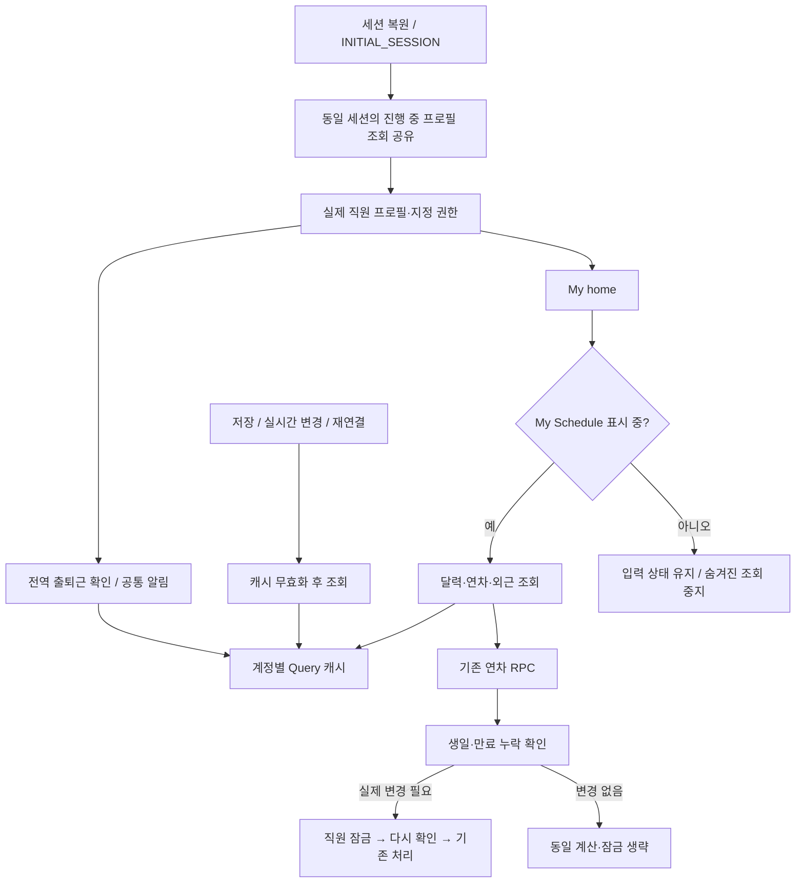

# 로그인·공통 알림·연차 조회 최적화

2026-11-04, 공유 브랜치 `261104-1`. 로컬 코드와 DB 보완안을 분리한다. **공유 DB 미적용, test/main 미배포**.

## 연결과 유지할 동작

- 인증은 동시에 시작된 같은 세션의 조회만 공유한다. 이후 로그인 이벤트·토큰 갱신·직접 새로고침의 권한 조회는 유지한다. 30초를 넘긴 응답은 기존 오류·재시도 화면으로 전환하고, 이전 계정의 늦은 응답은 버린다.
- 공통 조회는 15초 이내의 성공 결과를 재사용한다. 정상 알림 주기 30초와 회의 화면 주기 15초는 유지한다. 실패 시 즉시 재시도·다른 배지의 재시도는 막고 주기 재조회는 60초로 늦춘다. 수동 재조회·저장 후 갱신·실시간 갱신은 즉시 가능하다.
- 공통 업무·추가 연차 실시간 이벤트가 몰리면 150ms 동안 합쳐 한 번 조회한다. 최초 연결·재연결의 최신화와 기존 읽음·처리 필요 기준은 바꾸지 않는다.
- 숨겨진 My Schedule은 입력을 보존한 채 조회를 중지한다. 보이는 화면으로 돌아오면 유효한 캐시 또는 최신 조회를 사용한다. 전역 출퇴근 진입 확인·알림은 계속 동작한다. 계정 변경 시 이전 폼·검색을 초기화한다.
- DB 보완안은 기존 함수 4개의 내부 계산·잠금만 줄인다. 월별 증가·초기화·생일·만료·취소·선사용과 보류 중인 음수 처리 기준, 테이블·RLS·실행 권한·cron은 유지한다. 상세 범위와 복구는 [연차 검증 기록](../handoffs/20261104-leave-read-optimization.md)을 따른다.

## 일반 직원 검증 결과

외부 서버를 차단하고 실제 AuthProvider·React 화면·Query 훅을 실행한 모의 브라우저 결과다. 운영 응답 시간 개선율로 해석하지 않는다.

| 조건 | 결과 |
| --- | --- |
| 일반 직원 최초 인증의 프로필 조회 | 기존 2회 → 1회 |
| 일반 직원 회의 탭에서 숨겨진 My Schedule 관련 첫 조회 | 기존 조건 12개 → 4개, 전역 출퇴근·신청·승인자 조회 유지 |
| 같은 알림 소비자를 1개에서 12개로 증가 | 추가 서버 조회 0회 |
| 연속 실시간 업무/추가 연차 이벤트 | 종류별 조회 1회 |
| 조회 오류·새 배지·30초 경과 | 자동 재시도 폭주 없음, 60초에 한 번 재시도 |
| 오류 복구 | 정상 주기로 복귀, 수동·실시간 재조회 가능 |

일반 직원 본인 연차의 기본 예산 계산 2→1회, 관리자 35명 가용량 계산 70→35회도 로컬 DB에서 확인했다. 현재 운영 서버의 지연 원인이 전부 제거되었다는 의미는 아니다. 서버 내부 부하·서비스 연결은 별도 확인 대상이다.

## 검증 명령

- `npm run verify:auth-loading`, `npm run verify:shared-read-load`, `npm run verify:hidden-schedule`
- `npm run verify:leave-read-efficiency`, `npm run verify:leave-read-concurrency`
- 기존 로그인 복구·직원 전환·My home 알림·연차 알림·회의 시작 알림·출퇴근 진입/퇴근 확인·My Schedule 회의 검증
- `npm run verify:diagnostics`, `npm run build`, `npm run structure:map`, `npm run verify:structure-map`

공유 DB 함수 조회가 다시 연결 시간 초과로 실패한 상태다. 승인 후에도 연결이 정상화되고 원본 함수·이전 래퍼 정의가 준비한 기준과 일치하는지 확인해야 적용한다. 실제 DB·일반 직원 실환경 응답 시간 검증은 그 이후에 진행한다. test/main 반영도 별도 승인을 받는다.
