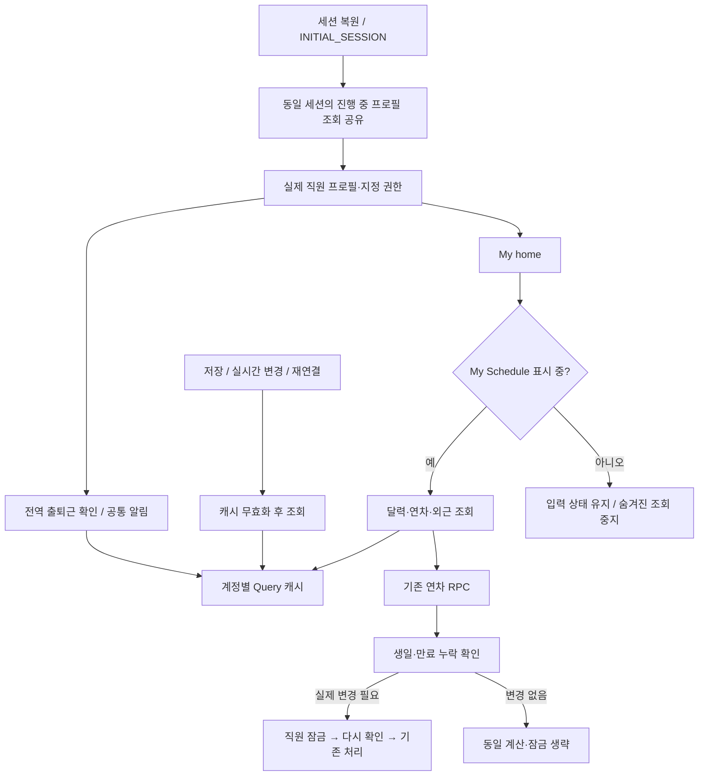
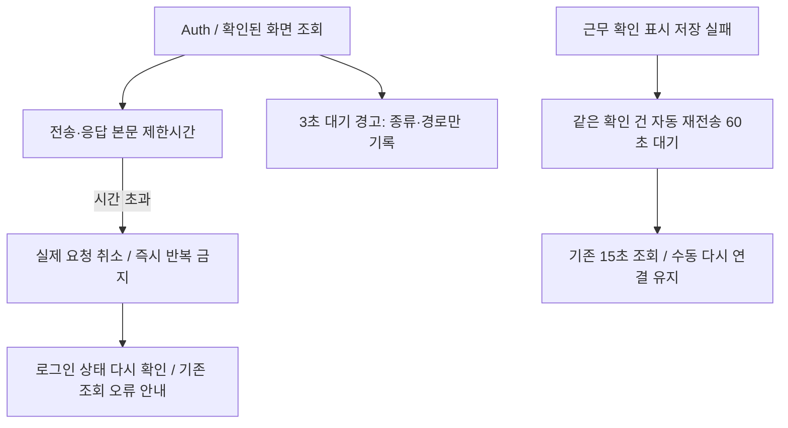

# 로그인·공통 알림·연차 조회 최적화

2026-11-04, 공유 브랜치 `261104-1`. **승인된 공유 DB 함수 4개 적용·보존 검증 완료, test/main 사이트 미배포**. 초기 최적화는 `05e5128`, 추가 504 대응은 아래 기록을 따른다.

## 연결과 유지할 동작

- 인증은 동시에 시작된 같은 세션의 조회만 공유한다. 이후 로그인 이벤트·토큰 갱신·직접 새로고침의 권한 조회는 유지한다. Auth 전송은 31초, 진입 단계는 35초로 제한하고 이전 계정의 늦은 응답은 버린다. 인증 SDK의 30초 재시도 창보다 전송 제한을 길게 두어 정지한 토큰 갱신을 두 번 보내지 않으며, 네트워크 장애로 저장된 세션을 지우지 않는다.
- 공통 조회는 15초 이내의 성공 결과를 재사용한다. 정상 알림 주기 30초와 회의 화면 주기 15초는 유지한다. 실패 시 즉시 재시도·다른 배지의 재시도는 막고 주기 재조회는 60초로 늦춘다. 수동 재조회·저장 후 갱신·실시간 갱신은 즉시 가능하다.
- 공통 업무·추가 연차 실시간 이벤트가 몰리면 150ms 동안 합쳐 한 번 조회한다. 최초 연결·재연결의 최신화와 기존 읽음·처리 필요 기준은 바꾸지 않는다.
- 숨겨진 My Schedule은 입력을 보존한 채 조회를 중지한다. 보이는 화면으로 돌아오면 유효한 캐시 또는 최신 조회를 사용한다. 전역 출퇴근 진입 확인·알림은 계속 동작한다. 계정 변경 시 이전 폼·검색을 초기화한다.
- DB 보완안은 기존 함수 4개의 내부 계산·잠금만 줄인다. 월별 증가·초기화·생일·만료·취소·선사용과 보류 중인 음수 처리 기준, 테이블·RLS·실행 권한·cron은 유지한다. 상세 범위와 복구는 [연차 검증 기록](../handoffs/20261104-leave-read-optimization.md)을 따른다.

## 일반 직원 검증 결과

외부 서버를 차단하고 실제 AuthProvider·React 화면·Query 훅을 실행한 모의 브라우저 결과다. 운영 응답 시간 개선율로 해석하지 않는다.

| 조건 | 결과 |
| --- | --- |
| 일반 직원 최초 인증의 프로필 조회 | 기존 2회 → 1회 |
| 일반 직원 회의 탭에서 숨겨진 My Schedule 관련 첫 조회 | 기존 조건 12개 → 4개, 전역 출퇴근·신청·승인자 조회 유지 |
| 같은 알림 소비자를 1개에서 12개로 증가 | 추가 서버 조회 0회 |
| 연속 실시간 업무/추가 연차 이벤트 | 종류별 조회 1회 |
| 조회 오류·새 배지·30초 경과 | 자동 재시도 폭주 없음, 60초에 한 번 재시도 |
| 오류 복구 | 정상 주기로 복귀, 수동·실시간 재조회 가능 |

일반 직원 본인 연차의 기본 예산 계산 2→1회, 관리자 35명 가용량 계산 70→35회도 로컬 DB에서 확인했다. 현재 운영 서버의 지연 원인이 전부 제거되었다는 의미는 아니다. 서버 내부 부하·서비스 연결은 별도 확인 대상이다.

## 검증 명령

- `npm run verify:auth-loading`, `npm run verify:shared-read-load`, `npm run verify:hidden-schedule`
- `npm run verify:leave-read-efficiency`, `npm run verify:leave-read-concurrency`
- 기존 로그인 복구·직원 전환·My home 알림·연차 알림·회의 시작 알림·출퇴근 진입/퇴근 확인·My Schedule 회의 검증
- `npm run verify:diagnostics`, `npm run build`, `npm run structure:map`, `npm run verify:structure-map`

## 504 장애 중 로컬 보완

- REST 조회는 25초로 제한한다. 기존 SDK의 GET 자동 재시도와 Query 재시도가 겹치지 않게 SDK 재시도를 끄고, 시간 초과에는 Query도 즉시 반복하지 않는다. 기존 일반 오류의 Query 재시도 1회는 유지한다. 업무 저장·알 수 없는 RPC·파일 전송에는 이 조회 제한을 적용하지 않는다.
- `INITIAL_SESSION(null)`만으로 로그인 실패를 정상 로그아웃으로 취급하지 않는다. 세션 조회 오류는 별도 재조회 화면으로 보내며, 기존 활성 직원을 신규 신청 화면으로 보내거나 승인 상태를 바꾸지 않는다.
- 근무 확인 `present` 실패 → 즉시 poll → 같은 `present`의 반복을 차단한다. 같은 건은 실패 후 60초 동안 자동 재전송을 보류한다. 수동 복구, 새 확인 건, 계속 근무·퇴근 응답과 서버 판정은 유지한다.
- 대기 중인 쿼리도 3초를 넘기면 해당 요청에 한 번 경고한다. 완료·취소·삭제·오프라인 전환 시 타이머를 정리한다. 쿼리 전체 키·검색값·직원 이름·클릭 문구는 새 진단 로그에 넣지 않는다.
- 실제 SDK의 로컬 HTTP 검증에서 헤더/본문 정지 취소, 호출자 취소 보존, 31초 Auth 갱신 1회·세션 보존, 쓰기·업로드 보존을 확인했다. 실제 근무 확인 컴포넌트와 QueryClient 검증에서 기존 실패 3회만으로 32ms에 present 4회/poll 4회가 재현됐고, 수정 후 즉시 반복이 사라졌다. 실제 운영 서버 개선율과 구분한다.

초기 MCP·CLI 조회는 접속 시간 초과, 마이그레이션 시도는 이력표 초기화 단계에서 실패했다. 사용자가 직접 재시작한 뒤 연결이 정상화되어 원본 함수 6개를 대조하고, 승인된 4개를 `20261104071756_leave_read_reconciliation_efficiency`로 적용했다. 동일 REPEATABLE READ 트랜잭션에서 기존 업무 표 13개·함수/표 ACL·RLS·소유자·함수 OID를 비교했고, 승인 대상 4개 정의만 바뀐 경우에만 COMMIT했다.

2026-11-04 15:30~15:42(KST) 서버 로그에서 `authenticator`의 57014 오류 17건(ERROR 15/FATAL 2), `supabase_auth_admin` 9건, `supabase_admin` 19건을 확인했다. 프로젝트 관리 상태는 `ACTIVE_HEALTHY`였지만 실제 DB 연결 정상성을 의미하지 않았다. 이 증거만으로 CPU·메모리·디스크·연결 풀 중 근본 원인을 확정하지 않는다.

일반 직원 authenticated 역할에서 본인 선사용/잔여 조회와 근태 기준 조회가 각각 약 75ms/6ms에 완료되고 본인 범위만 반환했다. 관리자 조회의 잔여 37명·추가 부여 3건 응답은 기존 래퍼와 전체 JSON이 같고, 일반 직원의 관리자 조회는 거부됐다. 시험 호출은 ROLLBACK하여 업무 이력을 남기지 않았다. 적용 전 표본은 약 38ms/5ms로, 이 두 표본만으로 속도 개선율을 주장하지 않는다.

## 재시작 뒤 재발 조사

- 공식 서비스 health API에서 재시작 전 DB/Auth/REST 모두 `UNHEALTHY`, 사용자 재시작 후 모두 정상 응답(약 1.16초)을 확인했다. 프로젝트의 `ACTIVE_HEALTHY` 표기만으로 정상 판정하지 않는다.
- 재시작 전 접속 21개/최대 60개·잠금 대기 0개였던 표본에서도 장애가 있었다. DB 300.4MB·임시 쓰기 누적 34,733.8MB는 현재 디스크 사용량이 아니며, 통계가 재시작으로 초기화되어 이전 장애의 직접 원인을 이 값만으로 단정하지 않는다.
- 07:14:41→07:16:28 UTC 동일 부팅의 지표에서 RAM 총 406.5MiB, 가용 149.6→96.8MiB, swap 사용 370.6→449.2MiB를 확인했다. 107초간 swap-in/out +66,693/+54,894 pages, major fault +73,852, CPU idle 80.1%·IO wait 11.9%였다. 부팅 이후에도 메모리와 디스크 사이 이동이 지속되며 CPU 계산 포화보다 메모리/IO 압박이 뚜렷하다. OOM·임시 파일·교착 증가 0은 이 관측 구간에 한정한다.
- E&J의 Pro와 프로젝트 1개를 API로 확인했다. 공식 안내상 유료 전환은 기존 Nano 컴퓨트를 자동 증설하지 않는다. 사용자가 별도 승인한 Micro 1GB 변경을 관리 API로 한 번 요청했고(HTTP 200), `ci_micro` 선택·07:25:28 UTC 새 부팅·DB/Auth/REST 정상 상태를 확인했다. OS 사용 가능 RAM 총량은 406.5→904.3MiB다. Pro $25 + Micro 약 $10 − 컴퓨트 크레딧 $10 = 기본 약 $25/월이며 세금·사용량 초과분은 별도다.
- [컴퓨트 과금·기존 Nano 안내](https://supabase.com/docs/guides/platform/manage-your-usage/compute), [메모리와 swap 해석](https://supabase.com/docs/guides/observability/reports). 지표 원본·인증·직원 UUID는 `.tmp`에서만 취급하고 저장소에 포함하지 않는다.

## Micro 변경 후 읽기 전용 원인 조사

사용자 사진의 16:13~16:19 KST는 변경 전이다. `Memory commitment`는 모든 프로세스에 약속한 가상 메모리(`Committed_AS`)이며 실제 RAM 사용량이 아니다. 경고는 무시하지 않되 실제 여유 메모리·swap 입출력·연결·응답을 함께 판단한다. 연결 프로세스와 정렬/해시 작업이 영향을 줄 수 있지만 현재 자료로 프로세스별 메모리 원인이나 누수를 확정하지 않는다.

| 측정 | 변경 전 07:14:41~07:16:28 UTC | Micro 07:26:29~07:28:30 | Micro 07:28:30~07:32:20 |
| --- | --- | --- | --- |
| 마지막 가용 RAM | 96.8MiB | 338.9MiB | 379.3MiB |
| swap-in / swap-out | 623 / 513 pages/s | 0 / 0 | 0.79 / 85.6 pages/s |
| CPU IO wait | 11.92% | 0.63% | 1.51% |
| swap 점유 변화 | +78.6MiB | −33.4MiB | +197.1MiB |

최신 commitment는 1612.9MiB로 CommitLimit 1476.1MiB를 넘지만 가용 RAM은 41.95%다. swap 쓰기는 다시 발생했고 지속적 무발생으로 보고하지 않는다. 실제 상주 익명 메모리는 369.8→297.0MiB, 캐시는 약 317MiB로 유지되고 여유는 늘었다. 심한 양방향 paging·RAM 고갈은 이 구간에 관측되지 않았으나 변경 직후 짧은 관찰이라 장기 안정성을 확정하지 않는다. 동일 부하의 통제 실험도 아니다.

- 연결은 Micro 샘플에서 20→24→27개/한도 60개, 풀 대기 0이다. 07:30:13 SQL 표본은 25개이며 대부분 유휴 연결, 잠금 대기·idle in transaction·오래 실행 중인 업무 쿼리는 없었다. 정상 WAL sender 대기를 정지한 업무로 분류하지 않는다. OOM·temp 파일·교착 증가는 관측 구간 0이다.
- 변경 후 07:26~07:30:10 로그는 Edge 978건 중 5xx 0, Auth 오류 0, PostgreSQL 취소/timeout 0, 연결 오류 1건(07:26:14)이다. 변경 전 06:30~07:21에는 5xx 365건·Auth 오류 153건·취소/timeout 88건이 있었으나 재시작 구간을 포함한다. 이전 마지막 5xx도 07:13:31이므로 Micro만으로 모든 장애가 해결됐다고 단정하지 않는다.
- 기존 개발자 계정으로 실제 로그인 130ms/HTTP 200, 본인 인증 54ms/200, 본인 프로필 77ms/200을 확인하고 검증 세션만 로그아웃(204)했다. 비밀번호·토큰·개인정보는 기록하지 않는다. 일반 직원의 실제 역할 조회 검증과 구분한다.

### 남아 있는 느린 경로

07:30:39 `pg_stat_statements` 표본이며 네트워크 시간을 제외한 DB 실행시간이다. 누적 통계를 초기화하지 않고 조회했다.

| 경로 | 호출 | 평균 | 근거와 후속 검토 |
| --- | ---: | ---: | --- |
| 창고 재고 페이지 | 3 | 2095ms | 재고·자리 중첩 조회, 선택 묶음을 페이지마다 가져와 화면에서 합산 |
| 브랜드 상품 개수 | 6 | 910ms | 브랜드 조회마다 정확한 COUNT, RLS 함수가 Index Only Scan의 행 필터에 남음 |
| 공통 업무 알림 | 45 | 236ms | 누적 10.6초로 해당 표본에서 가장 큰 총 실행시간; 공유 조회·중복 억제 배포 전후 비교 필요 |
| 회의 목록 | 82 | 67ms | 잦은 호출은 존재하나 해당 표본의 개별 실행은 상대적으로 짧음 |
| Realtime 변경 조회 | 532 | 9ms | 정상 실시간 polling과 업무 화면 중복 조회를 구분 |

`styles`는 약 2,460행, `warehouse_stock_positions`는 약 300,273행·188MiB(인덱스 포함)의 통계 추정값이다. 후자는 과거 묶음을 포함한 전체 표 크기로, 한 화면이 30만 행을 전부 읽는다는 뜻이 아니다. 실제 조회에는 brand/set 조건이 있다. 두 느린 경로의 임시 디스크 쓰기는 0이었다.

`countStylesByBrand` → `app.can_read_brand(brand_id)` → 프로필의 관리자/활성 판정 연결을 확인했다. 실제 authenticated 역할의 실행하지 않는 EXPLAIN에서도 행 필터가 남는다. 창고 재고/자리에는 읽기·편집 정책의 권한 함수와 중첩 조회가 함께 존재한다. 동일 권한 결과를 보존하는 중복 검사 축소와 필요한 재고 집계만 조회하는 방식을 다음 최적화 후보로 삼되, 이번 추가 조사는 코드·DB·권한을 바꾸지 않았다. 특정 쿼리가 RAM을 몇 MB 차지했는지는 현재 수집 지표로 확정할 수 없다.
